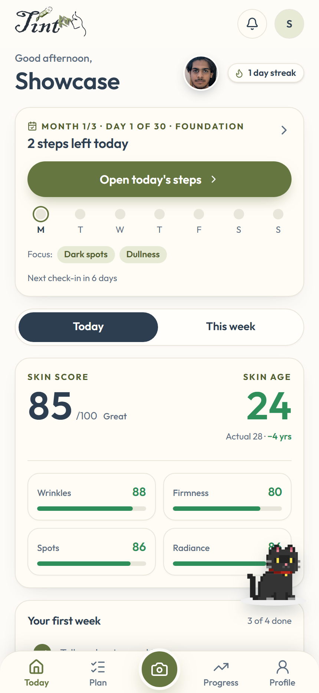
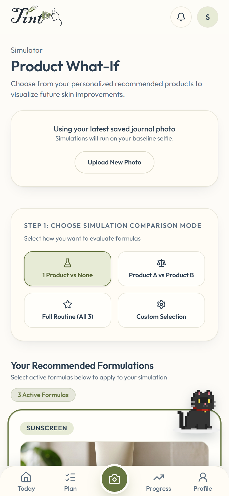

<div align="center">
  <h1>TintKin</h1>
  <p><strong>Your daily skin coach: a plan built for your skin, guided sessions, and a routine that adapts to how your skin reacts.</strong></p>
  <p>
    <a href="https://tint-kin.vercel.app/">TintKin</a>
  </p>
</div>

<br />

> **Submission for the YouCam API Skin AI & Apparel VTO Hackathon**

---

## 🔑 For the YouCam judges

**Try the app:** sign up at [tint-kin.vercel.app](https://tint-kin.vercel.app/). During the hackathon **every account gets Pro for free**: 12 scans, unlimited product checks, 4 simulations, custom-product simulations. No card needed.

**Admin portal (read-only):** [tint-kin.vercel.app/admin](https://tint-kin.vercel.app/admin)

| | |
|---|---|
| Email | `youcam@tintkin.demo` |
| Password | `YouCam-Judge-68otUeTl` |

This login is a separate **read-only viewer**. It shows aggregate metrics and a user list, but on the server:
- emails are masked (`a•••@g•••.com`)
- names are cut to an initial
- scores, skin age, birth dates, goals, health answers and photos are never sent
- refunds, tier changes, shop edits and feedback triage are blocked

The owner's admin login is separate and is not in this repo.

**Demo video:** _add the YouTube/Vimeo link here before submitting_

## 💰 Business model
Subscription only. TintKin does not sell products, so its advice stays independent.

| Tier | Price | Includes |
|---|---|---|
| Free | $0 | Adaptive plan, guided sessions, 2 scans, 3 product checks, 1 simulation a month |
| Standard | $8/mo | 6 scans, unlimited product checks, 3 simulations |
| Pro | $15/mo | 12 scans, unlimited product checks, 4 simulations, custom-product simulations |

Worst-case YouCam cost is about $3.15 a month for Standard and $5.92 for Pro, which leaves roughly 61% margin before fees. Daily coaching runs on our own engine and costs nothing per use. The full case is in [`docs/hackathon-pitch.md`](docs/hackathon-pitch.md).

## 💡 Inspiration
Skin apps give you a score, and then nothing happens. Testers kept asking "what am I getting from just my face result?" Routines found online ignore your skin, your safety (pregnancy, sensitivity), and how your skin reacts in the first weeks. That is exactly when most people quit or irritate their skin.

## 🚀 What it does
TintKin is a **daily skin coach**. It works like a workout programme for your skin.

* **An optional YouCam baseline before your plan.** After onboarding, add a selfie for measured starting scores or continue without a photo. Reliable scans establish a baseline; low-confidence scans are excluded from plan baselines and check-ins. The questionnaire continues to guide routine choices and safety rules.
* **A plan built for your skin.** A deterministic rules engine turns goals, skin type, phototype and safety answers into a staged plan: barrier care first, then one new active at a time. Pregnancy, "unsure" and sensitive skin are hard safety gates.
* **Guided daily sessions.** Morning and evening sessions come with step cards, timers, voice guidance and a reason for every step.
* **Actives on a ladder.** Retinoids run 1 → 2 → 3 → 4 nights a week, and acids 1 → 2 → 3. A step goes up a rung only after 14 calm days with 70% of its sessions done.
* **Adapts when your skin reacts.** After each session you tap Fine, Tingled, Irritated or Breakout. Irritation means three barrier-only days, then a restart one rung lower. A second reaction to the same ingredient swaps that step for a gentler one.
* **Progress you can trust.**
  * A one-tap mirror check each day. Feeling better on 5 of the last 7 days *earns* a YouCam scan to measure it.
  * Photo quality is checked before scoring, and low-confidence scans are marked.
* **Plan-aware product check.** Paste an ingredient list or snap the label. TintKin tells you what the product does, which of your goals it serves, whether it clashes with your plan, and anything to avoid for your profile.
* **What-If simulator.** See your own photo after a year of the routine.
* **Kin.** A companion who talks you through it and celebrates small wins. Matching static artwork keeps Kin recognizable while its animation loads.

<p align="center"></p>

## 💻 How we built it
TintKin is built on a modern, highly performant full-stack architecture:

* **Frontend:** Next.js (App Router), React, Tailwind CSS, JavaScript with JSDoc checks.
* **Backend & Storage:** Vercel for serverless execution, Cloudinary for secure and dynamic image processing, and MongoDB Atlas for structured user and historical data storage.
* **Authentication:** Auth.js (NextAuth v5) with email/password and Google sign-in, JWT sessions, and server-side session checks on every action. (The original hackathon build used Firebase Auth.)
* **AI & LLMs:** Qwen API for generating personalized, context-aware skincare advice and routines based on the metrics.

## 🌟 YouCam API Integration (The Core Engine)
The **YouCam AI Skin Analysis API** is the foundational engine of TintKin. We integrated it deeply into our capture and simulation workflows to provide skin measurements for a consumer wellness experience.

1. **The measuring instrument for the coach:** Baseline, scheduled check-in and *earned* scans all come from YouCam Skin Analysis. The coach decides when measuring is worth it, which keeps both cost and noise down. Each scan runs under a fixed time budget and backs off on `429` responses, so a busy moment queues briefly instead of failing.
2. **Precision Scanning:** When a user uploads an optional baseline or progress selfie, the image is securely passed to the YouCam API. We extract the granular data (Wrinkles, Firmness, Age Spots, Radiance) and the overall Skin Age to populate our MongoDB models and update the user's historical charts.
3. **"What-If" Visualizations:** We leverage the YouCam Simulation API to power our standout feature. By calculating the difference between a user's current routine and a proposed "What-If" intervention (like adding SPF daily), we map those deltas to YouCam's simulation intensities. The API returns a highly realistic, visually altered image illustrating a possible outcome, not predicting or guaranteeing how their skin will look.

<p align="center"></p>

These screenshots show the current demo account and interface. A simulation is illustrative, and its screen should not be read as a guaranteed result.

## 🧗 What we struggled with most
Our hardest problem was not technical: it was making people understand *why* they would use TintKin. When we put the first version in testers' hands, many opened it, saw a skin score, and asked what it was for. It took several rounds of feedback to turn YouCam's measurements into something people actually wanted.

What testers told us, and what we changed:
* **"What do I get from just my face result?"** A score alone gave them nothing to do. So the scan stopped being the product. The coach is the product, and YouCam measures whether it is working.
* **"Generic routines don't fit me."** We built the rules engine around their goals, skin type and safety answers, with hard gates for pregnancy and sensitive skin.
* **"I stopped when my skin got irritated."** We added the Fine / Tingled / Irritated / Breakout tap after each session, with a gentler restart and a slower ramp for actives.
* **"Why should I scan again?"** Scans are now *earned*: feel better on 5 of the last 7 days and YouCam measures whether it is real. That is where its precision matters most, so it is also where we spend credits.

The algorithm in the app today is the result of that feedback. It is what testers told us they needed, not what we first assumed.

## 🚧 Challenges we ran into
Building a complex, image-heavy AI app came with its hurdles. One of our primary technical challenges was handling the variability of the **YouCam API responses**. Depending on the scan results, the API returned either flat JSON objects or zipped files containing `score_info.json`. We had to build a robust, unified parsing utility capable of downloading, unzipping (using `fflate`), and standardizing the data on the fly.

Another challenge was adhering to the strict facial positioning requirements of the YouCam Simulation API. We had to implement dynamic, server-side face-cropping logic via Cloudinary transformations before sending images to YouCam to prevent simulation failures. Securely connecting Auth.js sessions to Next.js Server Actions and MongoDB required server-side authentication and ownership checks.

## 🏆 Accomplishments we're proud of
* **Seamless Full-Stack Architecture:** We successfully bridged Auth.js, MongoDB, Next.js, and multiple AI APIs into a single, cohesive user experience on Vercel.
* **Robust Data Pipelines:** Engineering a resilient, multi-step image processing pipeline that seamlessly uploads to Cloudinary, dynamically crops, queries YouCam, and securely caches the results.
* **Measurements Meet UI/UX:** Taking structured skin-analysis data from the YouCam API and transforming it into an empathetic, gorgeously designed, and easy-to-understand wellness journal.

## 🛠️ Development

**Prerequisites:** Node.js 22.14+, [Bun](https://bun.sh) 1.3 (the lockfile is `bun.lock`), a MongoDB Atlas cluster (a replica set — quota reservation uses transactions), and Cloudinary, YouCam, Qwen (DashScope) and Resend accounts.

```bash
bun install
cp .env.example .env.local   # then fill in the values; every variable is documented there
bun run dev                  # http://localhost:3000
```

| Command | What it does |
|---|---|
| `bun run dev` | Start the dev server |
| `bun run build` | Production build |
| `bun run start` | Serve the production build |
| `bun run lint` | ESLint |
| `bun run test` | Unit/regression tests (Node's built-in test runner, no extra dependencies) |
| `bun run type-check` | `tsc` over `lib/` |

Tests live in `tests/`. `tests/setup/register.mjs` maps the `@/` import alias so tests load the real source files; external services (YouCam, Cloudinary) are mocked with a stubbed `fetch`.

**Deployment (Vercel):** set every variable from `.env.example` in the project settings. `NEXTAUTH_URL` must be the public URL (it builds password-reset links), and Google OAuth needs `<url>/api/auth/callback/google` as an authorized redirect URI. See `AUDIT.md` for open production risks and required manual actions.

## 🔮 What's next for TintKin
The full design is in `docs/skin-coach-design.md`.
* Queued scans with a shared YouCam request budget and "you're number 4" progress.
* A face workout library, plus water and sleep modules.
* Programmes in 2-week blocks, from 2 to 24 weeks.
* Learning across consenting users: shared starting points, then safe A/B choices between equally safe options.
* A dermatologist review of the knowledge base, and a native app.

---

## Submission checks

See [the submission checklist](docs/submission-checklist.md) for the remaining release checks and demo recording outline. A public 1-3 minute demo video still needs to be recorded and linked in the Devpost submission.

Browser checks: `bun run test:e2e` (install Chromium once with `bunx playwright install chromium`). To test an already-running server, set `E2E_BASE_URL`; otherwise the suite starts a local production server and requires `bun run build` first.
